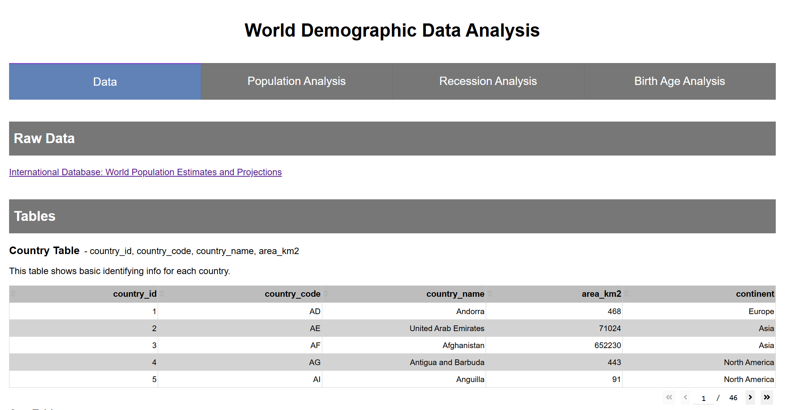

# World Demographic Data Pipeline & Analysis

A small data pipeline exploring population, migration, recessions, and fertility trends with the U.S. Census Bureau's International Database (IDB). A
Python ETL pipeline loads selected IDB fields into PostgreSQL, and a Dash application presents the data and interactive charts.

**This is an overview.** Analysis and its figures are available in the
[project report](docs/report.md).



## Questions & Takeaways

The project explores three questions:

| Question | Takeaways |
| ----- | ----- |
| Are population increases driven more by immigration or natural increase? | The balance between natural increase and net migration varies substantially by country. At the global level, migration redistributes population rather than changing the total, while births and deaths determine natural increase. |
| How do recessions relate to population, births, and life expectancy? | Population continued to grow in the recession windows examined. The report observed relatively small changes in several measures, with results varying by country and recession. |
| How has the age distribution of births changed over time? | The reported share of births shifted toward older age groups over time. |

## Tools

| Tool | Use |
| ----- | ----- |
| **Python**, **pandas** | Data preparation and ETL |
| **PostgreSQL**, **SQLAlchemy**, **psycopg** | Database storage |
| **Dynaconf**, **python-dotenv** | Database connection configuration |
| **Dash**, **Plotly** | Interactive dashboard and visualizations |

## Project Structure

```text
.
├── app/
│   ├── app.py # Run dashboard
│   └── ...
├── data/
├── db/
│   ├── world_demographics_schema.sql # Run database schema
│   └── ...
├── docs/
│   ├── report.md # Report
│   └── ...
├── etl/
│   ├── main.py # Run ETL
│   ├── etl.py
│   └── ...
├── .env.example
├── .gitignore
├── README.md # You are HERE
└── requirements.txt
```

## Setup

### Prerequisites

- Python
- PostgreSQL
- The U.S. Census Bureau IDB 5-year data file

### 1. Install dependencies

From the repository root, create and activate a virtual environment, then install packages:

```powershell
python -m venv .venv
.\.venv\Scripts\Activate.ps1
python -m pip install -r requirements.txt
```

### 2. Configure PostgreSQL

Create a PostgreSQL database, then copy [`.env.example`](.env.example) to `.env` and set credentials to match that database:

```text
DB_HOST=localhost
DB_PORT=5432
DB_USER=your_username
DB_PASSWORD=your_password
DB_DATABASE=your_database
DB_SCHEMA=world_demographics
DB_ENGINE_URL=postgresql+psycopg://${DB_USER}:${DB_PASSWORD}@${DB_HOST}:${DB_PORT}/${DB_DATABASE}?options=-c%20search_path=${DB_SCHEMA}
```

Run the [schema](/db/world_demographics_schema.sql) to build the database:

**Warning:** the schema script drops and recreates the `world_demographics` schema, deleting any existing tables and data in that schema. 

### 3. Add the source data and load it

Download the [IDB zip file](https://www.census.gov/data-tools/demo/data/idb/dataset/idbzip.zip) from the Census Bureau and extract `idb5yr.txt`. Save it to the project `data/` folder.

Run the ETL from the repository root:

```powershell
python etl\main.py
```

### 4. Start the dashboard

With the database populated and `.env` configured, run:

```powershell
python app\app.py
```

Open [http://127.0.0.1:8050](http://127.0.0.1:8050).

## Sources

- U.S. Census Bureau, [International Database: World Population Estimates and
  Projections](https://www.census.gov/programs-surveys/international-programs/about/idb.html)
- U.S. Census Bureau, [International Database 5-year API variable
  definitions](https://api.census.gov/data/timeseries/idb/5year/variables.html)
- U.S. Census Bureau, [International Database information and
  methodology](https://www.census.gov/programs-surveys/international-programs/about/idb.html)

The analysis in this repository uses the December 2025 IDB release. Check the Census Bureau pages for current data, definitions, release notes, and methodology before reproducing the analysis.
