# World Demographic Data Analysis

## 1. Overview

This project aims to analyze global demographic data with the main goal of identifying population and demographic trends to answer specific questions. I focused on population growth, migration, recessions, and age at childbirth.

I used the U.S. Census Bureau International Database which covers many countries over many decades. I extracted, transformed, and loaded the data using Python/Pandas into a PostgreSQL database, then visualized the data and my analysis with a Dash application.

## 2. Questions

I came up with three questions based on the demographic dataset:

- Are population increases due more to immigration or natural increase?
- How does Covid / Recession affect population, birth rates, life expectancy?
- How has the age at which women have children changed over time?

For each question I created a hypothesis:

- Population increases differ by country, but will weigh towards a natural increase.
- There would be a fairly steady, slightly lower, population with lower birth rates and lower life expectancy during a recession.
- The age would increase that women have children

## 3. Data

The data is sourced from the [U.S. Census Bureau’s International Database](https://www.census.gov/programs-surveys/international-programs/about/idb.html). The raw data has over 250,000 rows and 115 columns. A full data dictionary can be found [here](https://api.census.gov/data/timeseries/idb/5year/variables.html). The data consists of demographic and population estimates from 1950 to 2025. I broke the data into four tables:

- “Country”: basic identifying info for each country.
- “Age”: age ranges with their IDs for joining with other tables.
- “Demographics”: basic demographic info by year and country.
- “Age_Demographics”: combines demographic info with age range info.

An ERD can be seen below.

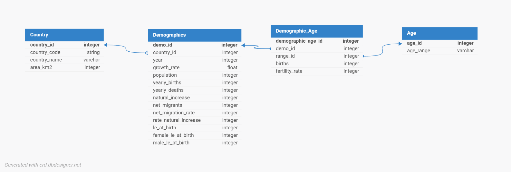

*Figure 1 – ERD*

## 4. Analysis

I did a population analysis, recession analysis, and birth age analysis, pairing with all three questions I wanted to answer.

### 4.1 Population Analysis

The first question I want to look at is whether population increases are more due to migration or natural increase.

Looking at overall population, we can see it has been increasing and if forecasted to continue, with total population into 8 billion in 2025.

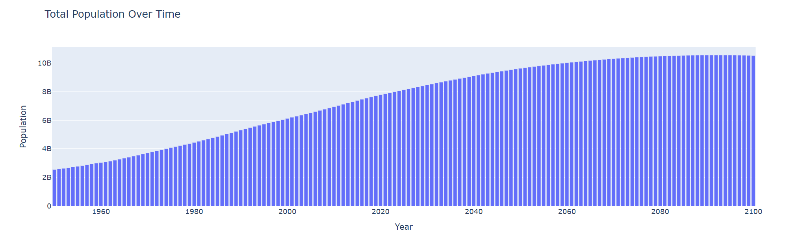

*Figure 2 – Total Population*

Now that we know overall population is increasing, what is driving it? Like I hypothesized, it is very country dependent. This shows the change in population from births/deaths (natural increase) versus the change from migrants. Comparing the United States and Zimbabwe, the U.S. sees lots of population growth from migration, but Zimbabwe sees lots of its population growth from births, with a decline from migration.

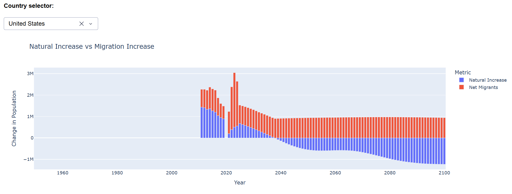

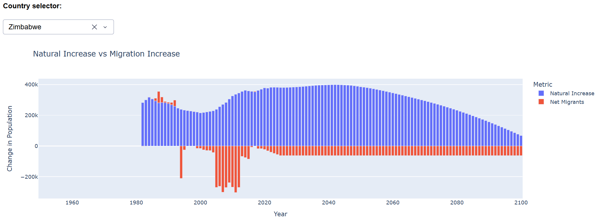

*Figure 3 & 4- Natural Increase vs Migration Increase: United States, Zimbabwe*

This graph shows the same information as the previous one but is standardized across all countries. We can see from this that world population increases are due to natural births, which makes sense because when everything is aggregated migration doesn't change the overall population.

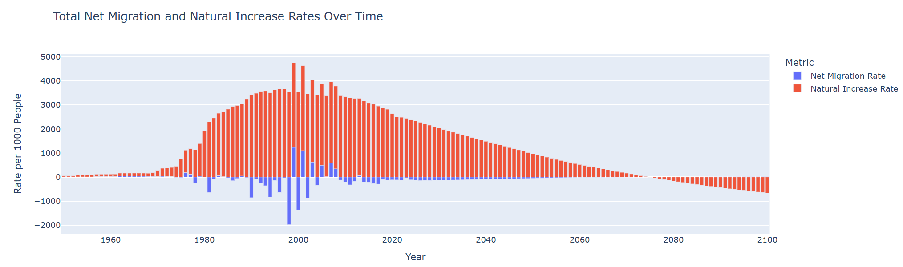

*Figure 5 – Total Net Migration Rates vs Natural Increase Rates*

We can see in this next scatter plot that there is little correlation between migrant versus natural population increases. It is interesting to see that China (overall) has people migrating away and a decrease in births, where India has had lots of people migrating away but has lots of births.

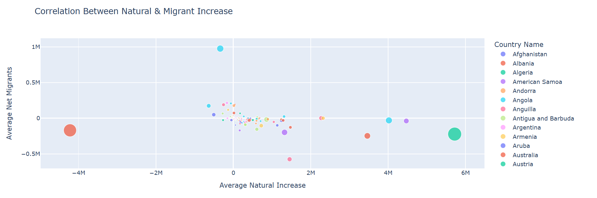

*Figure 6 – Correlation Between Natural Increase and Migrant Increase*

We can also look at a correlation matrix. We can see that there is little correlation between natural increase and net migration, which supports our other findings. North America has the largest correlation magnitude at -0.37. This means that over the years, when net natural increase tends to be higher, net migration tends to be somewhat lower (and vice versa), but the relationship isn't very strong.

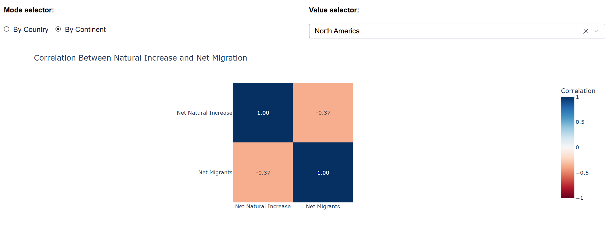

*Figure 7 – Correlation Matrix Between Natural Increase and Net Migration*

My hypothesis was correct in that increases are due to natural increase, but different countries see differing levels of net migration and natural increase.

### 4.2 Recession Analysis

The next topic I want to look at is how recessions affect population, birth rates, and life expectancy. I focused on three of the largest recessions featured in this dataset:

- 1981-1982 Recession: 1981-1982
- Great Recession: 2007-2009
- COVID-19 Recession: 2020

This first graph shows population changes before, during, and after a specific recession. Overall population seems to still grow during recessions, just at a steady or slower rate. The COVID Recession had the most dramatic decreases in population growth during and following the recession, but there were only minor differences.

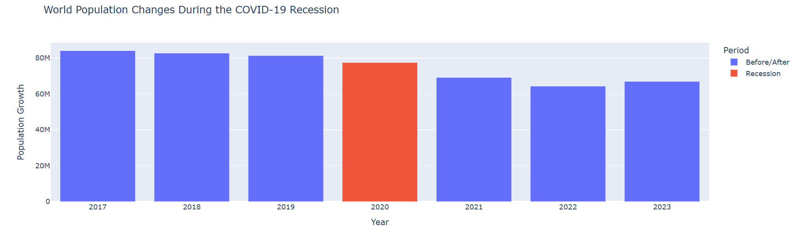

*Figure 8 – World Population Changes During the COVID-19 Recession*

Looking at life expectancy, it seems to remain steady even through recessions and across genders. It is likely that no recession will last long enough to significantly impact life expectancy.

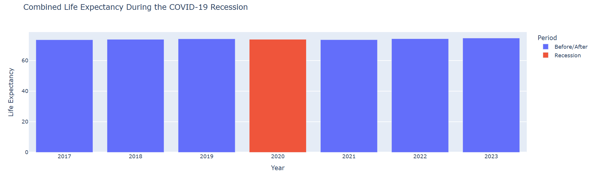

*Figure 9 – Combined Life Expectancy During the COVID-19 Recession*

This graph shows the same +3/-3 year time window around the recession but is clustered into total births/deaths/increase. This lets us see how each variable was impacted by the recession. The Great Recession had little impact on any of these metrics, while COVID and the 1981-1982 Recessions saw a slight dip in births. Most other variables remained constant.

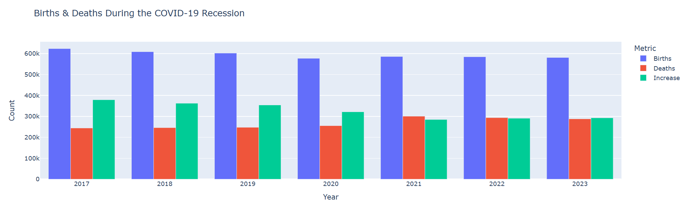

*Figure 10 – Births & Deaths During the COVID-19 Recession*

Now looking at growth rate, we can see from this map that a recessions impact on population growth rate is very country specific. Some countries will still have a high growth rate, while others will be very low. This is just due to the nature of how recessions impact a worldwide ecosystem.

It also gives us a view on the regional impact of a recession. The COVID Recession impacted the whole globe, but many of the countries in Africa still had a high population growth, showing it may not have impacted them as much.

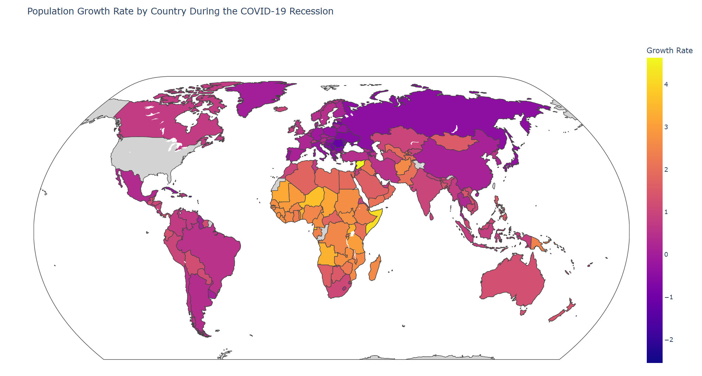

*Figure 11 – Population Growth Rate During the COVID-19 Recession*

Overall, population still grows during recessions, albeit at a slightly slower rate. Births and deaths also seem to remain fairly constant, and there is almost no change in life expectancy during a recession. This was not what I expected and proved my hypothesis incorrect.

### 4.3 Birth Age Analysis

The last question I want to analyze is how the age at which women have given birth changed over time.

By looking at overall fertility rates for groups of women we see that:

- Women 15-19, 40-44, and 45-49 have the lowest fertility rates, and have stayed consistent over time.
- Women 20-24 saw a rise in rates in 1980 before dropping back down.
- Women ages 25-34 have the highest fertility rate.

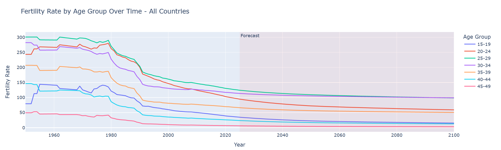

*Figure 12 – Fertility Rate by Age Group*

This chart shows the percentage of total global births each age group had. Similarly to the chart above, women used to have children earlier, but are now pushing it back to pursue a career or because more birth control options are available.

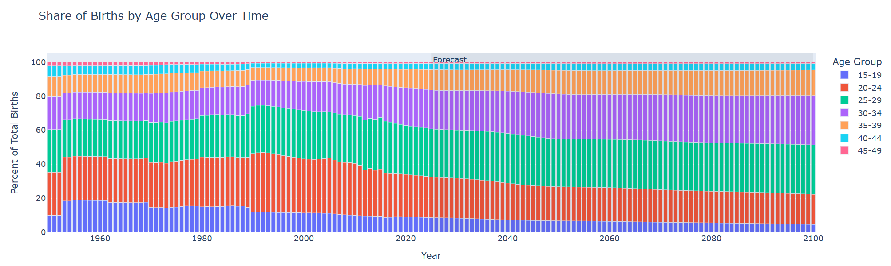

*Figure 13 – Share of Births by Age Group*

We can also look at average age women gave birth. Since 1955 they have birth fairly young, but since 2015, that age has been increasing which supports our other findings.

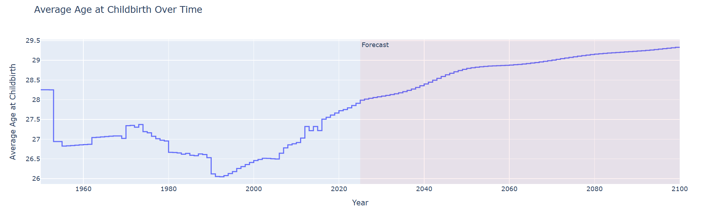

*Figure 14 – Average Age at Childbirth*

In conclusion, women have started having children later in life, which supports the hypothesis I made at the beginning. This could be due to many factors: pursuing a career, more birth control options, or overall culture/value changes.

## 5. App Overview

I created a Dash app that displays all my data and analysis. My app has 4 main tabs, one for data, and one for each of the questions I wanted to answer.

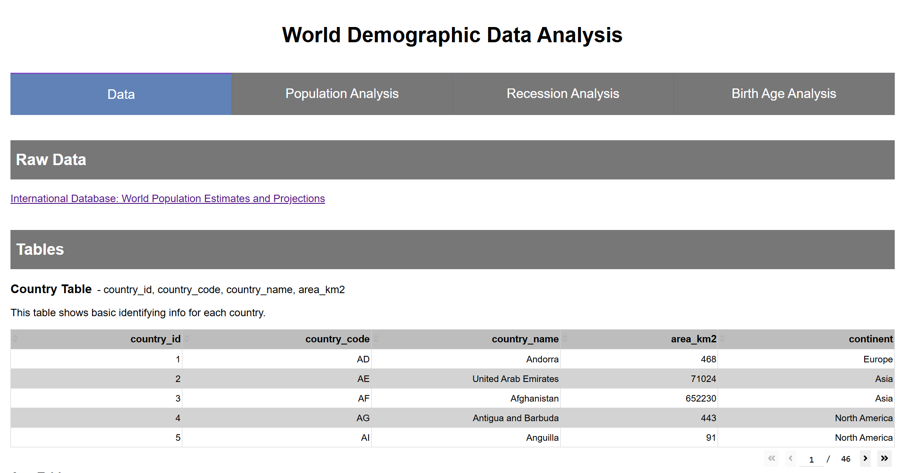

*Figure 15 – Data Tab*

My data tab has a link to the raw data, and a section to show all the tables I laid out in my ERD with example data in a table below them.

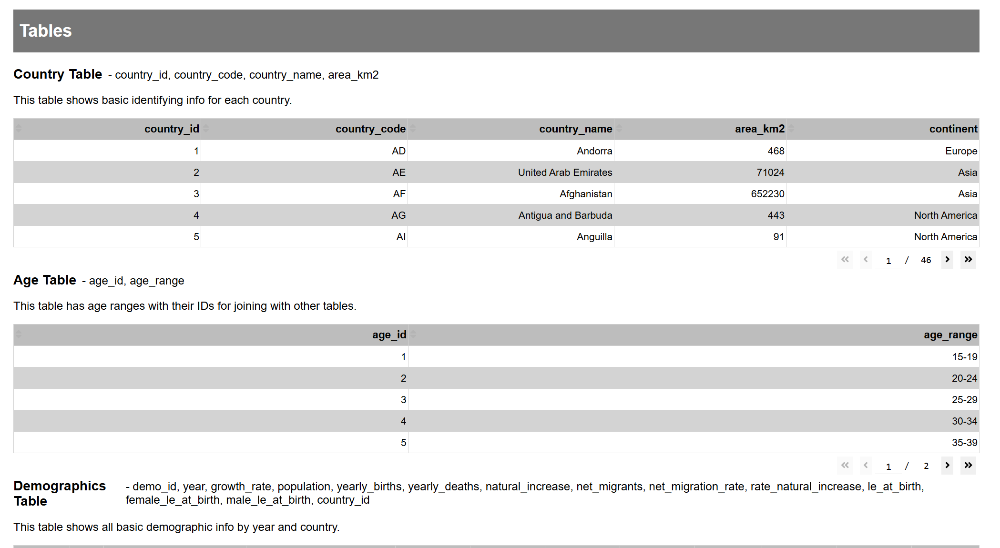

*Figure 16 – Data Tab: Tables*

The analysis tabs each have the question and short answer laid out at the top, followed by graphs and figures.

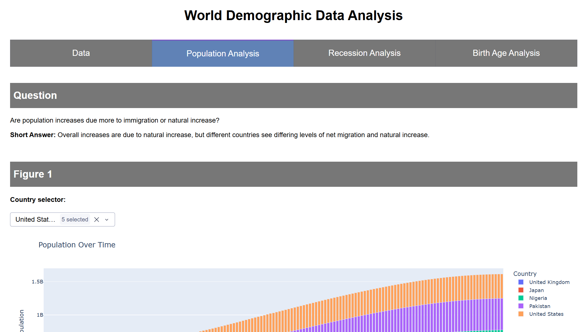

*Figure 17 – Population Analysis Tab*

Each section has a graph and a short description. Some sections have filters where appropriate.

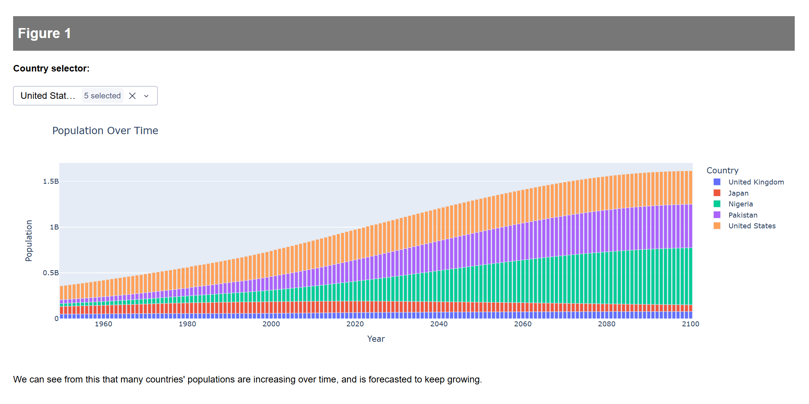

*Figure 18 – Population Analysis Tab: Figures*

## 6. ETL Overview

For my ETL I use SQLAlchemy to create a connection with my PostgreSQL database where I can load data in or extract it to use in my visualizations.

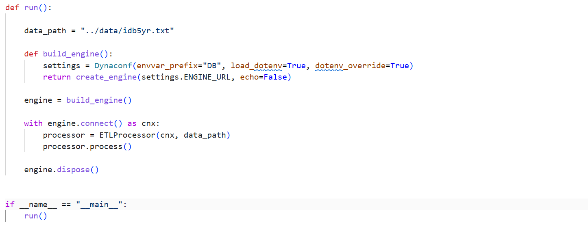

*Figure 19 – SQLAlchemy Engine*

I have an ETL Processor class that just processes each step: extract, transform, then load. It gives me printouts as it completes each step.

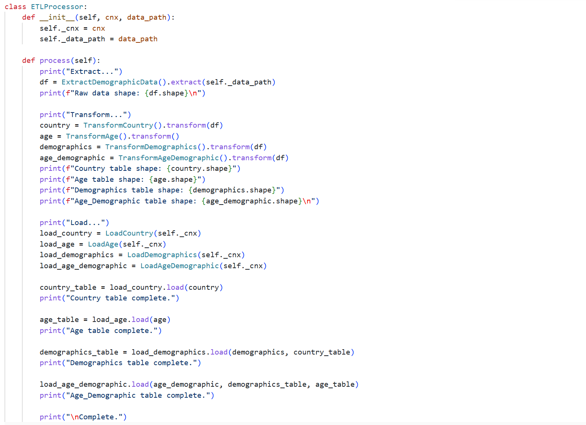

*Figure 20 – ETL Processor*

I use a class for each step in the ETL process. I have a class for extracting the data, a bunch of transforming classes for transforming each of my tables, and a bunch of classes that load each table into the database. Once the data is in my database, I’m ready to start the app.

*Figure 21, 22, 23 – Extract, Transform, Load Examples*

## 7. Sources

United States Census Bureau (2025). International Database: World Population Estimates and Projections [Data set]. https://www.census.gov/programs-surveys/international-programs/about/idb.html
